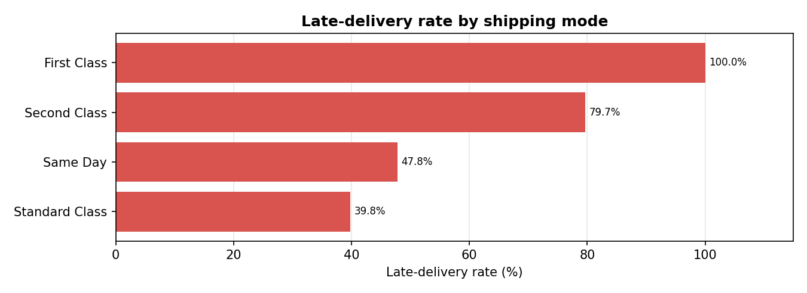
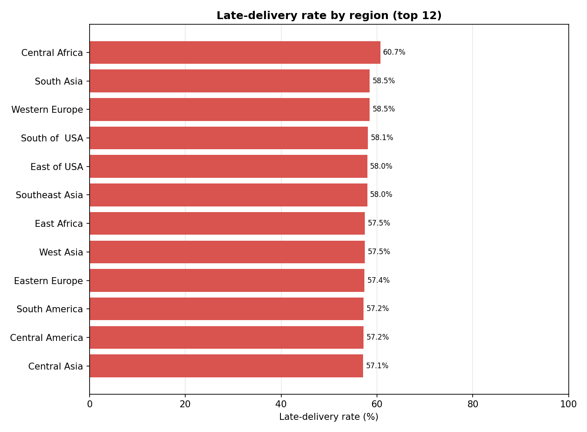
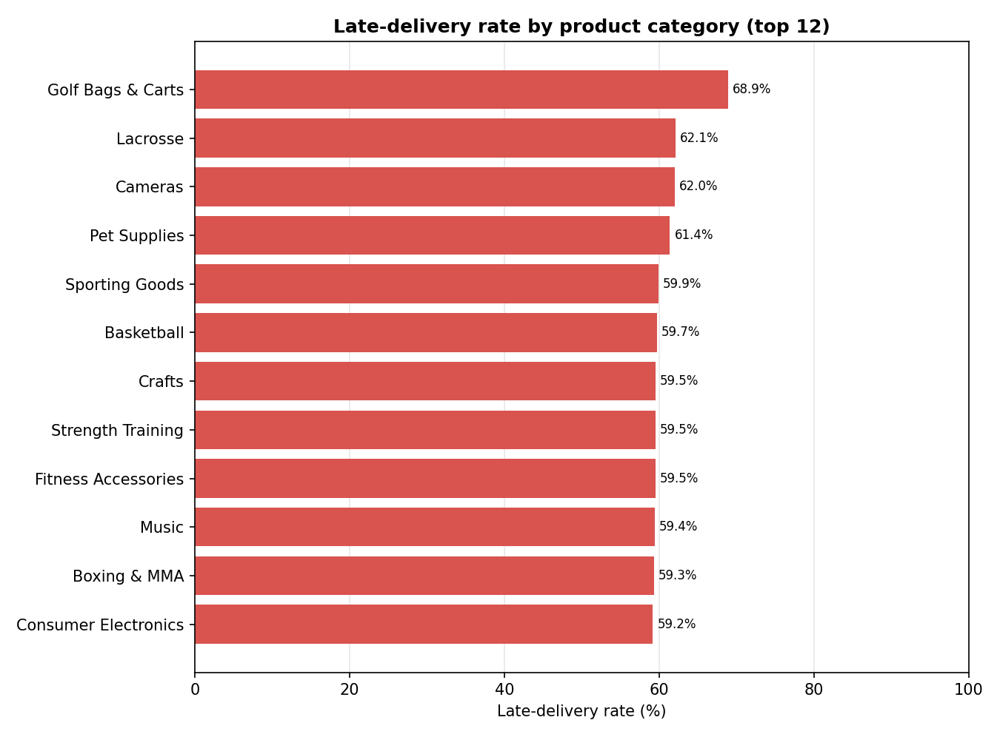

# Supply Chain Delay Risk Predictor

Predict whether an order will ship **later than promised**, and find the
operational **bottleneck segments** that drive delays, using the *DataCo Smart
Supply Chain for Big Data Analysis* dataset (180,519 orders).

Built with Pandas · scikit-learn · Matplotlib · Plotly · Streamlit.

## Quick start

```bash
pip install -r requirements.txt
python src/download_data.py     # fetch the dataset (Kaggle mirror, no token needed)
python run_pipeline.py          # clean -> EDA -> train -> evaluate (writes outputs/)
streamlit run dashboard.py      # KPI dashboard at http://localhost:8501
```

Optional checks:

```bash
python tests/test_dashboard_apptest.py   # runs dashboard.py headlessly (Streamlit AppTest)
python tests/test_dashboard.py           # boots the server and asserts HTTP 200
```

## Dataset

**DataCo Smart Supply Chain for Big Data Analysis** (Kaggle):
<https://www.kaggle.com/datasets/shashankthecookie/dataco-smart-supply-chain-for-big-data-analysis>

180,519 orders × 53 columns (order/shipping/delivery fields, product and
customer attributes, geo-market dimensions). The official Kaggle download
needs an API token, so `src/download_data.py` fetches a byte-identical public
mirror of the same CSV. Raw files live in `data/raw/` (git-ignored).

## Approach

1. **Target** — `late_delivery = 1` when
   `Days for shipping (real) > Days for shipment (scheduled)`, else `0`.
   Rate: **57.3%** late (103,401 orders). The derived label agrees **97.5%**
   with the dataset's own `Late_delivery_risk` flag.
2. **Cleaning** — dropped 33 columns: IDs, PII/free text (names, streets,
   e-mails), high-cardinality text (order city/state, product image),
   leaky post-hoc fields (`Delivery Status`, `Days for shipping (real)`,
   shipping date) and redundant geo-coordinates. Trailing whitespace in
   labels (`'Cameras '`) was trimmed, missing values imputed (median for
   numerics, mode for categoricals), and calendar features (month, year,
   weekday, weekend, hour) engineered from the order date.
3. **Encoding** — one-hot encoding for the 7 categoricals (shipping mode,
   region, market, category, department, customer segment, payment type)
   → **117 features**.
4. **EDA** — late-delivery rate grouped by shipping mode, market, region and
   product category; top-3 bottlenecks ranked (segments with ≥ 200 orders);
   3 bar charts saved to `outputs/figures/`.
5. **Modelling** — stratified 80/20 split (144,415 train / 36,104 test),
   Logistic Regression (with standardisation) vs Random Forest (300 trees),
   both seeded with `random_state=42`.

## Results

### Model comparison (hold-out test set)

| Model | Accuracy | Precision | Recall | F1 |
|---|---|---|---|---|
| Logistic Regression | 0.7111 | 0.8857 | 0.5690 | 0.6929 |
| **Random Forest** | **0.7203** | 0.8295 | **0.6441** | **0.7251** |

Confusion matrices (positive class = late):

- Logistic Regression — TN 13,906 · FP 1,518 · FN 8,913 · TP 11,767
- Random Forest — TN 12,686 · FP 2,738 · FN 7,360 · TP 13,320

The Random Forest wins on accuracy/F1/recall; Logistic Regression is more
conservative (higher precision, fewer false alarms).

### Top 3 bottleneck segments (≥ 200 orders)

| # | Dimension | Segment | Late rate | Orders |
|---|---|---|---|---|
| 1 | Shipping mode | **First Class** | **100.0%** | 27,814 |
| 2 | Shipping mode | **Second Class** | **79.7%** | 35,216 |
| 3 | Product category | **Lacrosse** | **62.1%** | 343 |

**First Class ships late on every order** — its promised window is always
exceeded — and Second Class is close behind. By comparison, Standard Class is
late only 39.8% of the time. Geographic variation is mild (Central Africa
60.7% worst vs Canada 51.9% best); category variation is moderate (Golf Bags
& Carts 68.9% worst, but only 61 orders).

### Top 5 feature importances (Random Forest)

| # | Feature | Importance |
|---|---|---|
| 1 | Days for shipment (scheduled) | 0.0890 |
| 2 | order_hour | 0.0798 |
| 3 | Shipping Mode_Standard Class | 0.0733 |
| 4 | Benefit per order | 0.0607 |
| 5 | Order Profit Per Order | 0.0606 |

The promised shipping time and the chosen shipping mode dominate — exactly
the levers an operations team can act on.

### Charts





## Dashboard

`streamlit run dashboard.py` serves:

- KPI cards — overall late rate **57.3%**, orders, RF accuracy/F1
- bar charts — late rate by shipping mode, region + feature importance
- model comparison table + top-3 bottlenecks
- **risk-score lookup** — pick shipping mode + region + category (+ promised
  days) → Random Forest probability of a late delivery with a Low/Medium/High
  band. Verified examples: *First Class → Western Europe → Cameras, 4 days*
  ⇒ **77.0% (HIGH)** vs *Standard Class → Canada → Computers, 4 days* ⇒
  **37.7% (LOW)**.

Verified locally: `python tests/test_dashboard.py` returns HTTP 200 on
`/_stcore/health` and `/` (server at `http://127.0.0.1:8501`), and
`python tests/test_dashboard_apptest.py` executes the full script headlessly
without exceptions.

## Project structure

```
├── data/
│   ├── raw/                  # DataCo CSV (downloaded, git-ignored)
│   └── processed/            # encoded modelling table (git-ignored)
├── src/
│   ├── config.py             # paths, column lists, constants
│   ├── download_data.py      # fetch dataset (Kaggle mirror)
│   ├── data_loader.py        # raw CSV loader
│   ├── preprocess.py         # cleaning, target, encoding
│   ├── eda.py                # bottleneck analysis + PNG charts
│   └── modeling.py           # LR/RF training & evaluation
├── tests/
│   ├── test_dashboard.py           # server smoke test (HTTP 200)
│   └── test_dashboard_apptest.py   # headless execution test
├── outputs/                  # charts, metrics.json, model.joblib (mostly git-ignored)
├── dashboard.py              # Streamlit KPI dashboard
├── run_pipeline.py           # one-command pipeline
├── requirements.txt
└── README.md
```

Git history is kept in logical steps: scaffold → data loading →
preprocessing → EDA → modelling → dashboard → fixes/tests → these results.


